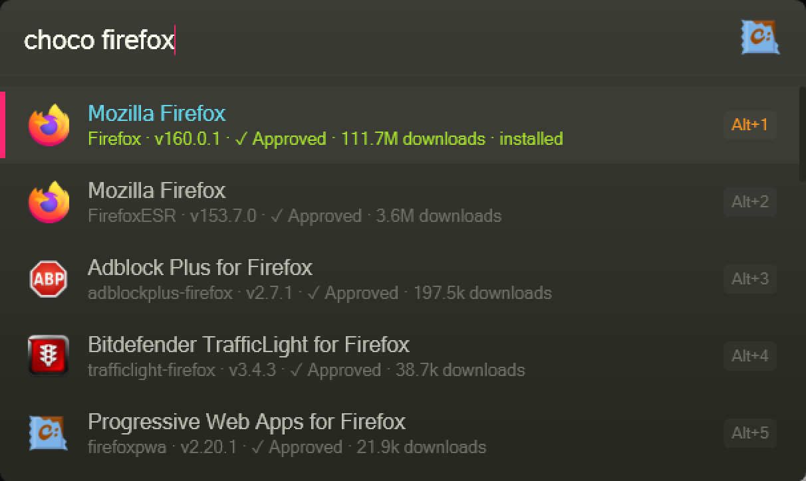
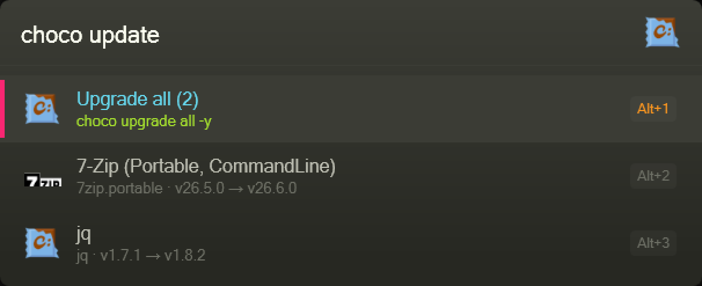
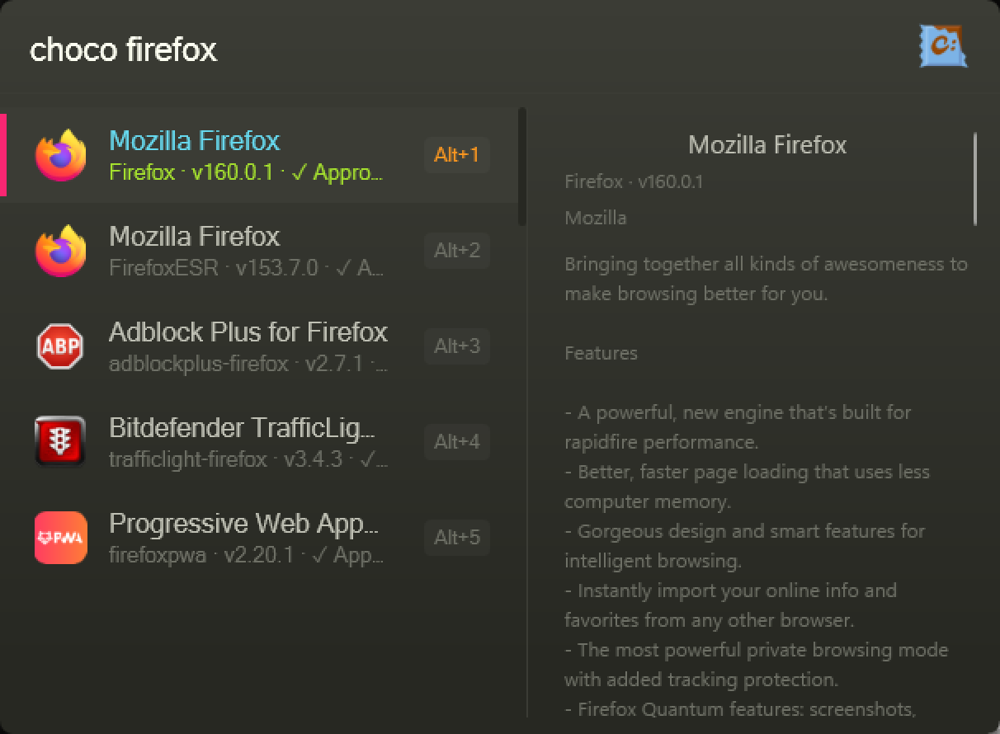
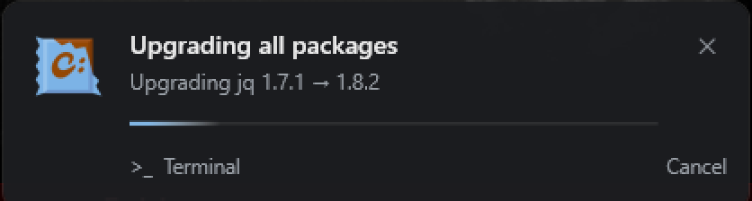
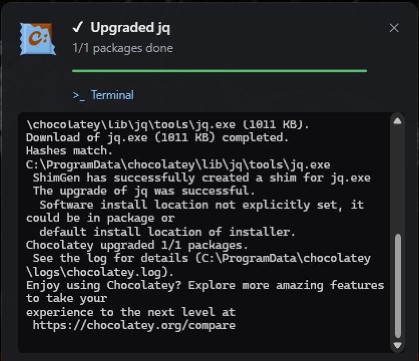
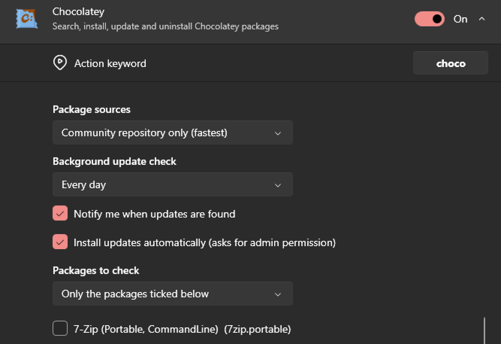

<div align="center">


# Chocolatey for Flow Launcher

Search, install, update and uninstall [Chocolatey](https://chocolatey.org) packages without leaving [Flow Launcher](https://www.flowlauncher.com).



</div>

## Install

In Flow Launcher:

```
pm install https://github.com/ITz-Viks/Flow.Launcher.Plugin.Chocolatey/releases/latest/download/Flow.Launcher.Plugin.Chocolatey.zip
```

Or download the zip from [Releases](https://github.com/ITz-Viks/Flow.Launcher.Plugin.Chocolatey/releases/latest) and run `pm install <path to zip>`.

## Usage

| Type | You get |
| --- | --- |
| `choco <name>` | Search with logo, version, approval badge and downloads. **Enter** installs, or upgrades if installed. |
| `choco update` | Only packages that have an update, plus *Upgrade all*. |
| `choco uninstall` | Your installed packages. **Enter** uninstalls (asks first). |
| `choco export` | Save your packages to a `packages.config` wherever you like. |
| `choco import` | Pick a `packages.config` and install what's missing. |

**F1** opens the details pane. **Right click** a package for install/upgrade, uninstall and its package page.

<div align="center">

<br>
<sub>Only what needs updating</sub>

<br>
<sub>Details pane (F1)</sub>

 <br>
<sub>Installs run hidden behind a small progress card with Cancel; the full choco output is one click away</sub>

</div>

### Safety

- Packages not approved by a Chocolatey moderator, and every uninstall, ask before running.
- If a download fails its checksum, the card offers a retry without the check and warns you about it. Only use it if you trust the source.
- Installing, updating and uninstalling need admin rights, so Windows asks each time (UAC).

## Settings



- **Package sources**: the community repository (default, fastest) or every source configured in Chocolatey, including private feeds and local folders.
- **Background update check**: off by default. Notifies you or updates automatically, for all packages, all except some, or only the ones you tick.

## Requirements

- Windows, Flow Launcher 2.0+
- Chocolatey. If it's missing, the plugin offers to install it with `winget`.

Follows Flow's language: English, Deutsch, Français, Español, Русский, 简体中文.

## Build

```
dotnet build -c Release -o out
pwsh ./selftest.ps1
```

Produces `Flow.Launcher.Plugin.Chocolatey.zip`. Pushing a `v*` tag builds it and attaches it to a GitHub release.

<sub>Not affiliated with or endorsed by Chocolatey Software, Inc.</sub>
